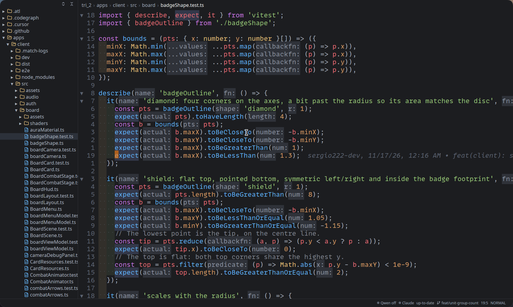
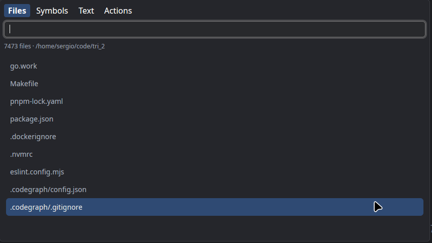
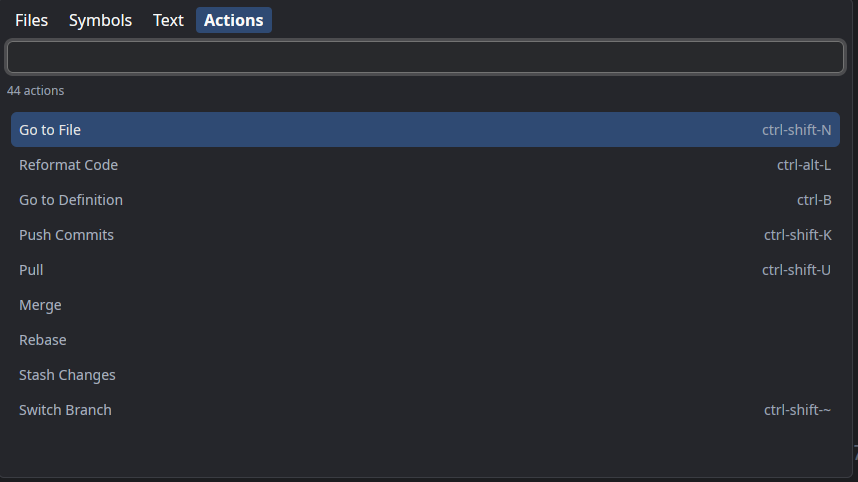

# Zide

A fast, keyboard-driven code editor with Vim motions and an IntelliJ-style keymap, written in Rust.



<p>
  
  
</p>

> [!NOTE]
> Zide is a personal project: an IDE built for my own use and workflow. It is shared as is, with no
> support, stability or roadmap promises, and features land when I need them.

> Zide was built with [Claude](https://claude.com/claude-code) (Claude Code) and is written in
> [Rust](https://www.rust-lang.org/), on top of the [GPUI](https://www.gpui.rs/) UI framework.

## What it is

Zide opens a project folder and gives you a code viewer/editor with the parts of an IDE you reach
for every day: search everywhere, a project tree, find and replace, code folding, a breadcrumb,
syntax highlighting and semantic Find Usages through language servers. Editing is modal (Vim),
while the shortcuts for IDE actions follow IntelliJ, so both muscle memories work.

Only Linux x86_64 is published for now.

## Features

- **Vim editing** with key hints, auto-indent, code folding and a customizable keymap.
- **Search Everywhere** (double-Shift), find and replace, Find in Files.
- **Language servers** for Find Usages, Go to Definition, code completion and signature help.
- **AI suggestions** (off by default) from a local model through Ollama.
- **Git**: branch switcher, commit panel, push, pull, merge and rebase dialogs, conflict resolver and Git log.
- **Claude chat** with configurable agents (Claude Code or ACP agents such as Copilot).
- **Project tree**, minimap, git blame, sticky scroll, breadcrumb, Markdown preview, self-updater.

## Documentation

- [Editor features](docs/editor.md): everything the editor does, in detail.
- [Keybindings](docs/keybindings.md): shortcuts, project tree keys.
- [Vim keymap](docs/vim.md): fold and scroll keys, rebinding keys, the opcode list.
- [Themes](docs/themes.md): the built-in themes, choosing one, writing your own.
- [Git](docs/git.md): branch switcher, push, pull, merge, rebase, conflicts, Git log.
- [Claude chat](docs/chat.md): chat keys, workers, configuring the agent.
- [Language servers](docs/language-servers.md): which servers Zide uses and how to install them.
- [Development](docs/development.md): tests, git hooks, debug environment variables.
- [Releasing](docs/releasing.md): how a release is cut.

## Install

One line (installs to `~/.local/bin`, or `$ZIDE_BIN_DIR`):

```sh
curl -fsSL https://raw.githubusercontent.com/sergio222-dev/Zide/main/scripts/install.sh | sh
```

Pin a version with `ZIDE_VERSION=0.1.1`. If `minisign` is installed the download signature is
checked.

**By hand**: download `zide-<version>-x86_64-unknown-linux-gnu.tar.gz` from the
[releases page](https://github.com/sergio222-dev/Zide/releases), then:

```sh
tar -xzf zide-*-x86_64-unknown-linux-gnu.tar.gz
install -Dm755 zide-*/zide ~/.local/bin/zide
zide --version
```

**From source** (Rust, edition 2024):

```sh
git clone https://github.com/sergio222-dev/Zide.git
cd Zide
cargo build --release -p zide-ui
./target/release/zide
```

Make sure `~/.local/bin` is on your `PATH`.

### Uninstall

```sh
curl -fsSL https://raw.githubusercontent.com/sergio222-dev/Zide/main/scripts/install.sh | sh -s -- --uninstall
```

Add `--purge` to also delete settings, sessions, language servers and caches
(`~/.local/share/zide`, `~/.cache/zide`).

## Usage

```sh
zide              # opens the current directory
zide path/to/project
zide --version
```

Zide updates itself: run **Update Zide** from the Actions tab (double-Shift) when the status
line says a new release is available.

From the Actions tab, **Close Project** goes back to the welcome screen, **Recent Projects** lists
the projects opened before (Enter opens one in this window) and **Open** picks a folder.

Shortcuts are listed in [Keybindings](docs/keybindings.md).

### Project folder

Zide keeps what it remembers about a project (last open file, where each file was left, font
size, which panels were showing, the Claude conversation the chat was on and the titles of its agents) in the project's own `.zide/` folder, which ignores itself through a `.gitignore` inside.
Delete the folder to forget it; `--purge` on uninstall does not touch it.

### Language servers

Zide does not ship language servers; it uses the ones you have for Rust, TypeScript/JavaScript,
Go and Python. See [docs/language-servers.md](docs/language-servers.md).

## Development

See [Development](docs/development.md) and [Releasing](docs/releasing.md).

## Credits

Zide is developed with the [Gentle AI](https://github.com/Gentleman-Programming/gentle-ai)
harness by [Gentleman Programming](https://github.com/Gentleman-Programming), which configures
the agent workflow (persistent memory, skills and spec-driven development) used to build it.

## License

Apache-2.0
