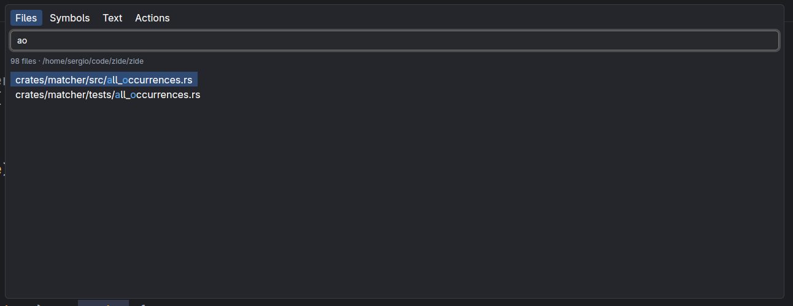
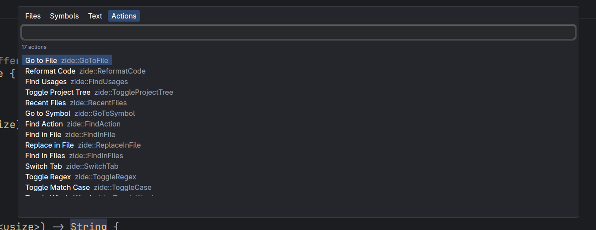

# Zide

A fast, keyboard-driven code editor with Vim motions and an IntelliJ-style keymap, written in Rust.


<p>
  
  
</p>

> Zide was built with [Claude](https://claude.com/claude-code) (Claude Code) and is written in
> [Rust](https://www.rust-lang.org/), on top of the [GPUI](https://www.gpui.rs/) UI framework.

## What it is

Zide opens a project folder and gives you a code viewer/editor with the parts of an IDE you reach
for every day: search everywhere, a project tree, find and replace, code folding, a breadcrumb,
syntax highlighting and semantic Find Usages through language servers. Editing is modal (Vim),
while the shortcuts for IDE actions follow IntelliJ, so both muscle memories work.

Only Linux x86_64 is published for now.

## Features

- **Vim editing**: motions, operators (`d`, `c`, `y`), visual modes, text objects, registers,
  dot repeat, undo/redo, `Ctrl+A` / `Ctrl+X` to increment / decrement the number under the cursor, `Ctrl+/` to comment or uncomment the line or the selection
  with the file's language markers (`//`, `#`, `<!-- -->`).
- **Search Everywhere** (double-Shift): files, text in the project, recent files and actions in
  one popup. Go to File, Go to Symbol and Find Action have their own shortcuts.
- **Find and replace** in the file (with regex, case and whole-word toggles) and Find in Files.
- **Find Usages** (`Alt+F7`): semantic through a language server, text search as a fallback.
- **Go to Definition** (`gd` or `Ctrl+B`): through a language server; without one it jumps by name in the
  symbol index and the status line says so.
- **Status bar**: messages on the left; on the right the branch's state against its upstream (`↑` to push, `↓` to pull,
  `Δ` when diverged), the branch name, the cursor position and the vim mode.
- **Branch switcher** (``Ctrl+Shift+` ``, click the branch in the status bar, or Find Action → *Switch Branch*): Recent, Local, Remote and
  Tags as folder trees (`feat/` holds `feat/*`), searchable; Enter checks out, a remote branch gets a
  tracking local one and a tag is checked out detached.
  Right-click a branch for its menu: *New Branch from…*, *Update* (fast-forward only), *Push…* (asks first, never forced)
  and *Rename* (the dialog refuses a name that already exists).
- **Push dialog** (`Ctrl+Shift+K`, or Find Action → *Push Commits*): the commits the remote lacks on the left, the files of the
  selected commit on the right with its message, author and date under them. `Enter` or a double click on a file opens what
  the commit changed in it, side by side (green added, gray removed, blue replaced); `Ctrl+Enter` or **Push** pushes (never
  forced), and *Push tags* sends the tags too.
- **Pull, Merge and Rebase dialogs** (`Ctrl+Shift+U` pulls; Find Action → *Pull*, *Merge*, *Rebase*): `git <command>` with the
  branch taken from a dropdown (`Tab` switches, `Up`/`Down` open and move, `Enter` picks, then `Enter` runs; typing in a dropdown narrows its list down). *Modify options*
  (`Alt+O`) lists what git accepts, shown as chips once picked; what cannot go with a picked option is dimmed. Options that take
  text (`-m`, `--onto`) show a box for it; rebase can also pick another branch to rebase.
- **Conflict resolver** (Find Action → *Resolve Conflicts*, offered only while git reports conflicts): when a merge, rebase,
  cherry-pick or revert stops on conflicts, a dialog lists each file with what both sides did to it. *Accept Yours* keeps
  the current branch's version of the selected file, *Accept Theirs* the incoming one (a side that deleted the file deletes it);
  the file is then marked resolved. *Merge…* (or a double click on the file) opens the merge editor: yours on the left, theirs on the right and the result
  (it starts as the common ancestor) in the middle. The arrow of a change (`»` / `«`) puts it in the result — both sides go one
  under the other — and the cross (`✕`) leaves it out; additions are green, removals gray, replacements blue and changes both
  sides made red. The toolbar applies every non-conflicting change (`F7` / `Shift+F7` move between changes); *Apply* is enabled
  once no conflict is left, and writes the result and marks the file resolved. The result can be typed over: click or use the
  arrows, `Home`/`End`, type, `Enter`, `Backspace`, `Delete`, `Ctrl+V` to paste, `Ctrl+Z` to undo. Typing does not settle a
  change: it keeps its color and arrows until its sides are applied or discarded (an arrow puts the side's lines over what was
  typed). A line break cannot be removed where it would join two parts of the file (an empty line at the edge of a part can).
  While a merge, rebase, cherry-pick or revert is unfinished the status bar shows it (`Merging feature-branch`); with a merge, the
  commit panel (`Ctrl+K`) opens with git's message (`Merge branch 'feature-branch'`) and commits everything staged to conclude it.
- **Minimap** at the right of the editor: every line as colored bars (folded lines are left out), the visible part
  marked, click or drag to jump. Lines added or modified since the last commit are painted green or brown, removed ones
  gray, errors red and the cursor's line blue.
  Turn it off with Find Action → *Show Minimap* (Enter flips it, the popup stays open; the project remembers it).
- **Code folding** for blocks, declarations, imports and long comments, with gutter chevrons.
- **Git blame** in gray after the cursor line: author's last name, date, time and commit summary.
- **Matching pairs**: the caret on a bracket highlights its partner; on a JSX tag name, the other tag; on the `:` of a Python block, the block's last line.
- **Sticky scroll**: the class and function declarations that scrolled out of view stay pinned at the top of the editor (up to five, outermost first).
- **Project tree** panel, with IntelliJ ordering and reveal of the open file.
- **Markdown preview** (`Ctrl+Shift+M`): the rendered file beside the editor for `.md` files, updated as you type.
- **Navigation history**: the mouse's back and forward buttons (and `Ctrl+Alt+Left` / `Ctrl+Alt+Right`) return to where the cursor was before each jump (opening a file, go to line, Find Usages, a link).
- **Syntax highlighting** with tree-sitter (Rust, JavaScript, TypeScript, TSX, Go, Python, Markdown).
- **Breadcrumb** with the enclosing symbols at the cursor.
- **Whitespace dots and rainbow indent guides**, per-project font size (Ctrl+wheel to zoom).
- **Navigation**: next/previous method (`Alt+Down` / `Alt+Up`), extend/shrink selection.
- **Autosave** and live reload of the project tree.
- **Self-updater**: checks GitHub Releases at startup and verifies the minisign signature
  before installing.

## Install

One line (installs to `~/.local/bin`, or `$ZIDE_BIN_DIR`):

```sh
curl -fsSL https://raw.githubusercontent.com/sergio222-dev/Zide/main/scripts/install.sh | sh
```

Pin a version with `ZIDE_VERSION=0.1.1`. If `minisign` is installed the download signature is
checked.

**By hand**: download `zide-<version>-x86_64-unknown-linux-gnu.tar.gz` from the
[releases page](https://github.com/sergio222-dev/Zide/releases), then:

```sh
tar -xzf zide-*-x86_64-unknown-linux-gnu.tar.gz
install -Dm755 zide-*/zide ~/.local/bin/zide
zide --version
```

**From source** (Rust, edition 2024):

```sh
git clone https://github.com/sergio222-dev/Zide.git
cd Zide
cargo build --release -p zide-ui
./target/release/zide
```

Make sure `~/.local/bin` is on your `PATH`.

### Uninstall

```sh
curl -fsSL https://raw.githubusercontent.com/sergio222-dev/Zide/main/scripts/install.sh | sh -s -- --uninstall
```

Add `--purge` to also delete settings, sessions, language servers and caches
(`~/.local/share/zide`, `~/.cache/zide`).

## Usage

```sh
zide              # opens the current directory
zide path/to/project
zide --version
```

Zide updates itself: run **Update Zide** from the Actions tab (double-Shift) when the status
line says a new release is available.

From the Actions tab, **Close Project** goes back to the welcome screen, **Recent Projects** lists
the projects opened before (Enter opens one in this window) and **Open** picks a folder.

### Shortcuts

| Keys | Action |
| --- | --- |
| double-Shift | Search Everywhere |
| `Ctrl+Shift+N` | Go to File |
| `Ctrl+Alt+Shift+N` | Go to Symbol |
| `Ctrl+Shift+A` | Find Action |
| `Ctrl+E` | Recent files |
| `Ctrl+F` / `Ctrl+R` | Find / Replace in file |
| `F3` / `Shift+F3` | Next / previous match |
| `Ctrl+Shift+F` | Find in Files |
| ``Ctrl+Shift+` `` | Switch Branch |
| `Ctrl+Alt+A` | Add to Git: start tracking the selected file or folder in the tree (the open file elsewhere) |
| `Ctrl+Shift+U` | Pull dialog: remote and branch to pull into the current branch (`Tab` switches field, `Enter` pulls, `Alt+O` options) |
| `Ctrl+Shift+K` | Push dialog: commits to push, their files and diffs (`Tab` switches list, `Enter` opens the diff, `Ctrl+Enter` pushes) |
| `Alt+F7` | Find Usages |
| `gd` / `Ctrl+B` | Go to Definition |
| `Alt+1` | Toggle project tree |
| `Alt+Shift+\`` | Scroll the project tree to the open file and select it |
| `Ctrl+K` | Commit panel: tick files, write a message, **Commit** or **Commit and Push…** (`Amend` folds them into the last commit) |
| Commit panel `j`/`k`, `Space`, `Enter` | Move over the files, tick or untick one, open its changes (`Tab` or `i` goes to the message, `Alt+Enter` commits, `Esc` back to the files or out) |
| Double click on a commit panel file | Its changes against the last commit, side by side, in a large dialog (`Esc` closes, double `Space` opens search) |
| Commit panel **Stash** tab | The stashes of the repository (message and branch) and the files of the selected one; **Apply**, **Pop** and **Drop** (asks twice). `j`/`k` pick a stash, `a` applies, `p` pops; double click a file to see its changes |; **Stash…** (or Find Action → *Stash Changes*) asks for a message and whether to take untracked files or keep staged changes in place
| `a` / `m` / `d` / `y` / `p` | In the tree: new file (a name ending with `/` makes a folder), move or rename (a popup with the path, Enter applies, Esc closes), delete (asks first), copy, paste (into the selected folder; a taken name gets ` copy`) |
| `Ctrl+Shift+-` / `Ctrl+Shift+=` | With the tree focused: collapse / expand every folder (the buttons on top of the tree do the same) |
| `Ctrl+Alt+Left` / `Ctrl+Alt+Right` | Navigate back / forward (also the mouse's back and forward buttons) |
| `Ctrl+Shift+M` | Toggle Markdown preview (`.md` files) |
| `Ctrl+H` / `Ctrl+L` | Focus tree / editor |
| `Alt+Down` / `Alt+Up` | Next / previous method |
| `Ctrl+W` / `Ctrl+Shift+W` | Extend / shrink selection |
| `Ctrl+-` / `Ctrl+=` | Collapse / expand region (add `Shift` for all) |
| `Ctrl+Alt+L` | Reformat code |
| `Alt+C` / `Alt+W` / `Alt+R` | Toggle case / whole word / regex in the find panel |

In the Claude chat (`Alt+2` opens it): `Alt+Up` / `Alt+Down` switch between open chats,
`Alt+I` focuses the message input, `Alt+H` opens (or closes) the list of earlier conversations, `Esc` interrupts a running turn (or closes the chat when idle),
`Ctrl+V` pastes an image (click one, in the message or above the input, to see it large; `Esc` closes it), and `/` and `@` open the command and file menus. Earlier conversations
are also listed by **Claude: Resume Session** in Find Action (`Ctrl+Shift+A`).

In the Git log (`Alt+3` opens it): the refs tree on the left (HEAD, Local, Remote, Tags) narrows the history to
the ref you pick, and picking it again goes back to every branch. `/` focuses the search box (message,
author or the start of a hash), `Tab` moves between refs, commits and files, `j` / `k` or the arrows move,
`Enter` on a file (or a double click) opens that commit's diff, and `Esc` closes the tab.
The **User** button (`u`; `Up`/`Down` move, `Enter` picks, `Esc` closes) narrows the history to one author. **Date**
(`d`) lists *Last 24 hours*, *Last 7 days* and *Last 30 days*, and *Select...* opens an *After* and a *Before* date
picker (the clear button of each one drops it); and the **Paths**
box (`p`) keeps the commits that touch any of the paths typed, separated by spaces. The filters combine with the search
and the branch; while any is on, the graph is drawn as plain dots because the commits shown are no longer a connected history.
Right click on a commit opens its menu (`Up`/`Down` and `Enter` work too, `Esc` closes it): *Copy Revision Number*,
*Cherry-Pick*, *Reset Current Branch to Here...* (asks for Soft, Mixed, Hard or Keep), *Revert Commit*, *New Branch...*
(created from that commit and checked out) and *New Tag...*. A cherry-pick or revert that clashes leaves its conflicts
for the resolver, as a merge does.

The files of the selected commit take `Ctrl+click` to add or drop a file, `Shift+click` (or `Shift+Up`/`Down`) for a
range and `Space` to toggle the one under the cursor. Right click on them opens *Show Diff*, *Revert Selected Changes*
(undoes them in the working tree), *Cherry-Pick Selected Changes* (applies them) and *Get from Revision* (overwrites the
files with their version in that commit). None of them commits or stages anything.

Vim fold keys (`za`, `zo`, `zc`, `zM`, `zR`) and scroll keys (`zt`, `zz`, `zb`, `Ctrl+D`,
`Ctrl+U`) work in normal mode.

In the project tree (`Alt+1` focuses it): `j` / `k` / `h` / `l` or the arrows move and expand,
`gg` / `G` go to the first / last row, `Ctrl+D` / `Ctrl+U` move half a page, `Enter` opens.

### Frame rate (debug)

`ZIDE_FPS=1 zide` shows an overlay with the rate of the burst of frames in progress (a scroll
glide, for instance), the frames of the last second, the longest wait between two frames of a
burst and the time spent building the view. The window only redraws when
something changes, so read it while scrolling or holding a movement key.

### Update notification (debug)

`ZIDE_FAKE_VERSION=0.0.1 zide` makes the update check believe it runs that version, so the
"Update available" notification shows up. The Update button installs the real latest release.

### Project folder

Zide keeps what it remembers about a project (last open file, where each file was left, font
size, which panels were showing, the Claude conversation the chat was on and the titles of its agents) in the project's own `.zide/` folder, which ignores itself through a `.gitignore` inside.
Delete the folder to forget it; `--purge` on uninstall does not touch it.

### Language servers

Zide does not ship language servers; it uses the ones you have for Rust, TypeScript/JavaScript,
Go and Python. See [docs/language-servers.md](docs/language-servers.md).

## Development

```sh
cargo test --workspace
git config core.hooksPath .githooks   # once: formatting on commit, CI's checks on push
```

Releasing is described in [docs/releasing.md](docs/releasing.md).

## Credits

Zide is developed with the [Gentle AI](https://github.com/Gentleman-Programming/gentle-ai)
harness by [Gentleman Programming](https://github.com/Gentleman-Programming), which configures
the agent workflow (persistent memory, skills and spec-driven development) used to build it.

## License

Apache-2.0
