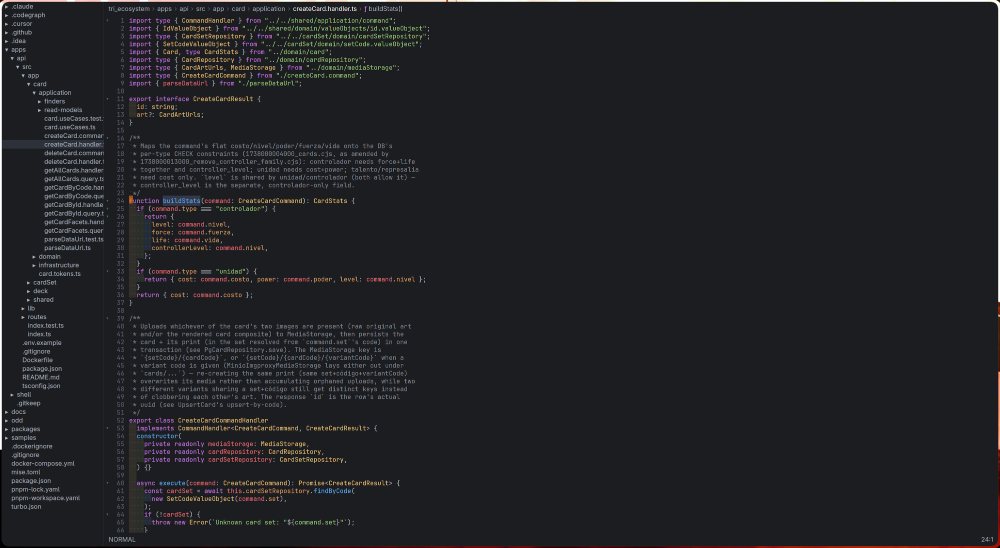

# Zide

A fast, keyboard-driven code editor with Vim motions and an IntelliJ-style keymap, written in Rust.



> Zide was built with [Claude](https://claude.com/claude-code) (Claude Code) and is written in
> [Rust](https://www.rust-lang.org/), on top of the [GPUI](https://www.gpui.rs/) UI framework.

## What it is

Zide opens a project folder and gives you a code viewer/editor with the parts of an IDE you reach
for every day: search everywhere, a project tree, find and replace, code folding, a breadcrumb,
syntax highlighting and semantic Find Usages through language servers. Editing is modal (Vim),
while the shortcuts for IDE actions follow IntelliJ, so both muscle memories work.

Only Linux x86_64 is published for now.

## Features

- **Vim editing**: motions, operators (`d`, `c`, `y`), visual modes, text objects, registers,
  dot repeat, undo/redo.
- **Search Everywhere** (double-Shift): files, text in the project, recent files and actions in
  one popup. Go to File, Go to Symbol and Find Action have their own shortcuts.
- **Find and replace** in the file (with regex, case and whole-word toggles) and Find in Files.
- **Find Usages** (`Alt+F7`): semantic through a language server, text search as a fallback.
- **Code folding** for blocks, declarations, imports and long comments, with gutter chevrons.
- **Git blame** in gray after the cursor line: author's last name, date, time and commit summary.
- **Project tree** panel, with IntelliJ ordering and reveal of the open file.
- **Syntax highlighting** with tree-sitter (Rust, JavaScript, TypeScript, TSX, Go, Python).
- **Breadcrumb** with the enclosing symbols at the cursor.
- **Whitespace dots and rainbow indent guides**, per-project font size (Ctrl+wheel to zoom).
- **Navigation**: next/previous method (`Alt+Down` / `Alt+Up`), extend/shrink selection.
- **Autosave** and live reload of the project tree.
- **Self-updater**: checks GitHub Releases at startup and verifies the minisign signature
  before installing.

## Install

One line (installs to `~/.local/bin`, or `$ZIDE_BIN_DIR`):

```sh
curl -fsSL https://raw.githubusercontent.com/sergio222-dev/Zide/main/scripts/install.sh | sh
```

Pin a version with `ZIDE_VERSION=0.1.1`. If `minisign` is installed the download signature is
checked.

**By hand**: download `zide-<version>-x86_64-unknown-linux-gnu.tar.gz` from the
[releases page](https://github.com/sergio222-dev/Zide/releases), then:

```sh
tar -xzf zide-*-x86_64-unknown-linux-gnu.tar.gz
install -Dm755 zide-*/zide ~/.local/bin/zide
zide --version
```

**From source** (Rust, edition 2024):

```sh
git clone https://github.com/sergio222-dev/Zide.git
cd Zide
cargo build --release -p zide-ui
./target/release/zide
```

Make sure `~/.local/bin` is on your `PATH`.

### Uninstall

```sh
curl -fsSL https://raw.githubusercontent.com/sergio222-dev/Zide/main/scripts/install.sh | sh -s -- --uninstall
```

Add `--purge` to also delete settings, sessions, language servers and caches
(`~/.local/share/zide`, `~/.cache/zide`).

## Usage

```sh
zide              # opens the current directory
zide path/to/project
zide --version
```

Zide updates itself: run **Update Zide** from the Actions tab (double-Shift) when the status
line says a new release is available.

### Shortcuts

| Keys | Action |
| --- | --- |
| double-Shift | Search Everywhere |
| `Ctrl+Shift+N` | Go to File |
| `Ctrl+Alt+Shift+N` | Go to Symbol |
| `Ctrl+Shift+A` | Find Action |
| `Ctrl+E` | Recent files |
| `Ctrl+F` / `Ctrl+R` | Find / Replace in file |
| `F3` / `Shift+F3` | Next / previous match |
| `Ctrl+Shift+F` | Find in Files |
| `Alt+F7` | Find Usages |
| `Alt+1` | Toggle project tree |
| `Ctrl+H` / `Ctrl+L` | Focus tree / editor |
| `Alt+Down` / `Alt+Up` | Next / previous method |
| `Ctrl+W` / `Ctrl+Shift+W` | Extend / shrink selection |
| `Ctrl+-` / `Ctrl+=` | Collapse / expand region (add `Shift` for all) |
| `Ctrl+Alt+L` | Reformat code |
| `Alt+C` / `Alt+W` / `Alt+R` | Toggle case / whole word / regex in the find panel |

Vim fold keys (`za`, `zo`, `zc`, `zM`, `zR`) and scroll keys (`zt`, `zz`, `zb`, `Ctrl+D`,
`Ctrl+U`) work in normal mode.

### Language servers

Zide does not ship language servers; it uses the ones you have for Rust, TypeScript/JavaScript,
Go and Python. See [docs/language-servers.md](docs/language-servers.md).

## Development

```sh
cargo test --workspace
```

Releasing is described in [docs/releasing.md](docs/releasing.md).

## License

Apache-2.0
